# Metodología

## Catorce días para ver dos días adelante

::: {.columns}
::: {.column width="55%"}
- Entrada: **336 h** (14 días) de caudal y 11 variables meteorológicas.
- Salida: el caudal de las **48 h siguientes**, en mm/h.
- **508 cuencas**, divididas en el tiempo: 254 000 ventanas de train, 18 142 de validación y 27 983 de test.
- Implementamos **DMEL** (Wang et al., 2026, *Applied Soft Computing*).
:::

::: {.column width="45%"}
<div class="metric">
<strong>508</strong>
cuencas
</div>

<div class="metric">
<strong>336 h → 48 h</strong>
pronóstico directo
</div>

<div class="metric">
<strong>12</strong>
variables por hora
</div>
:::
:::

::: {.notes}
(≈1 min) Presentar la tarea: pronóstico multivariable y multi-paso. Remarcar que la variable objetivo es
el caudal específico (mm/h) y que las cuencas aparecen en train, validación y test, en periodos distintos.
:::

## ¿Por qué es difícil?

::: {.columns}
::: {.column width="52%"}
- El caudal es muy asimétrico: mediana de 0.02 mm/h y picos de 15 mm/h.
- Su escala cambia **tres órdenes de magnitud** entre cuencas.
- No hay fechas: no hay estacionalidad explícita.
- Las crecidas empiezan con lluvia que **aún no cayó**.
:::

::: {.column width="48%"}
**Persistencia** (repetir el último valor), validación:

| Horizonte | NSE mediano |
|---|---:|
| 1 h | 0.998 |
| 6 h | 0.957 |
| 12 h | 0.841 |
| 24 h | 0.581 |
| 48 h | 0.223 |
:::
:::

::: {.key-message}
En las primeras horas basta con copiar el último valor; el reto está entre 24 y 48 h.
:::

::: {.notes}
(≈1 min) La persistencia es nuestro modelo base ingenuo. Cualquier modelo útil debe superarla en los
horizontes largos.
:::

## La idea de DMEL

```{mermaid}
%%| fig-width: 11
%%| fig-height: 4
flowchart LR
    A["Caudal"] --> B["CEEMDAN · modos"]
    B --> C["Sample entropy · complejidad"]
    C --> D["RIMF de alta frecuencia"]
    C --> E["RIMF de baja frecuencia"]
    D --> F["Informer"]
    E --> G["LSTM"]
    F --> H["suma = pronóstico"]
    G --> H
```

::: {.key-message}
Separar el caudal según su complejidad y darle cada parte al modelo que mejor la aprende.
:::

::: {.notes}
(≈40 s) Dos piezas: la estrategia de reconocimiento modal (MRS) y el ensamble dual. Las presentamos en
orden.
:::

## Paso 1 · CEEMDAN separa el caudal en modos

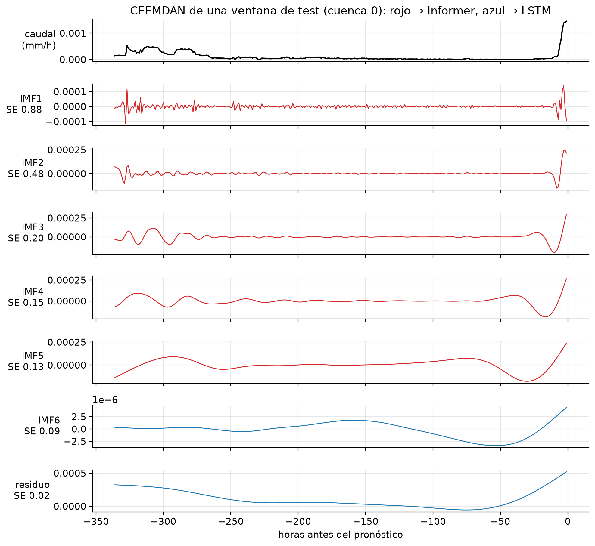{.r-stretch fig-alt="Caudal de una ventana y sus seis IMF más el residuo."}

::: {.tiny .muted}
$r_k=\langle M(r_{k-1}+\beta_{k-1}E_k(w^{(i)}))\rangle$, $\mathrm{IMF}_k=r_{k-1}-r_k$: se agrega ruido
blanco, se promedian 100 realizaciones y la suma de los modos reconstruye la señal exactamente.
:::

::: {.notes}
(≈1 min) Explicar que cada IMF oscila a una escala de tiempo: IMF1 captura el ruido hora a hora y el
residuo la tendencia. El color anticipa la decisión del MRS.
:::

## Paso 2 · Sample entropy mide la complejidad

$$
\mathrm{SampEn}(m,r)=-\ln\frac{A}{B}
$$

::: {.columns}
::: {.column width="55%"}
- $B$: pares de plantillas de largo $m$ que se parecen (distancia $<r$).
- $A$: los mismos pares, pero de largo $m+1$.
- Si al alargar la plantilla se pierden coincidencias, la serie es impredecible.
- Paper: $m=2$, $r=0.2\,\sigma$.
:::

::: {.column width="45%"}
| Señal | SE |
|---|---:|
| Ruido blanco | ≈ 2.2 |
| Seno de 24 h | ≈ 0.3 |
| Caudal horario (mediana) | ≈ 0.06 |
:::
:::

::: {.notes}
(≈45 s) El caudal horario es muy regular: su entropía es baja. Los primeros IMF son mucho más
irregulares que la serie original.
:::

## Paso 3 · MRS: agrupar por complejidad

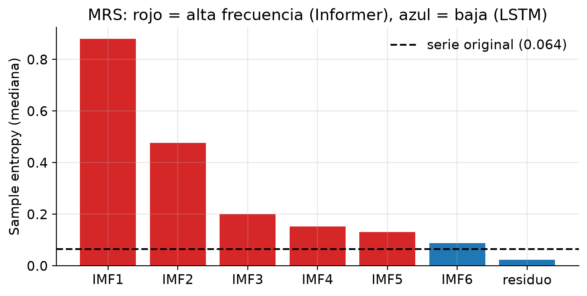{.r-stretch fig-alt="Sample entropy de cada componente frente a la serie original."}

::: {.compact}
RIMF con entropía **mayor** que la serie original → alta frecuencia → **Informer**. El resto → baja
frecuencia → **LSTM**.
:::

::: {.notes}
(≈45 s) En nuestro dataset IMF1 a IMF5 quedan como RIMF individuales de alta frecuencia; IMF6 y el
residuo forman el único RIMF de baja frecuencia. Es el mismo patrón que la estación Shuangpai del paper.
:::

## Paso 4 · Un modelo para cada frecuencia

::: {.columns}
::: {.column width="50%"}
**Informer → alta frecuencia**

- Atención **ProbSparse**: solo las queries más activas.
- **Distilling**: Conv1d → ELU → MaxPool, 336 → 168.
- **Decoder generativo**: las 48 h en una pasada.
:::

::: {.column width="50%"}
**LSTM → baja frecuencia**

- Compuertas que conservan la memoria de largo plazo.
- 2 capas de 256 unidades.
- Linear(256 → 48) desde el último estado.
:::
:::

$$
\hat{y}=\hat{y}_{\text{Informer}}(\mathrm{RIMF}_{\mathrm{HF}})+\hat{y}_{\text{LSTM}}(\mathrm{RIMF}_{\mathrm{LF}})
$$

::: {.notes}
(≈1 min) La hipótesis del paper: la atención capta cambios bruscos y dependencias largas en lo
irregular; la LSTM capta la tendencia suave. La predicción final es la suma (Ec. 14).
:::

## ProbSparse: atención solo donde importa

::: {.auto-flow .dense}
::: {.flow-box}
**Muestrear claves**

$U=c\ln L$
:::

::: {.flow-arrow}
$\longrightarrow$
:::

::: {.flow-box}
**Medir cada query**

$\max-\text{media}$
:::

::: {.flow-arrow}
$\longrightarrow$
:::

::: {.flow-box}
**Top-$u$ queries**

atención completa
:::

::: {.flow-arrow}
$\longrightarrow$
:::

::: {.flow-box}
**Resto**

media de $V$
:::
:::

$$
\bar{M}(\mathbf{q}_i,\mathbf{K})=\max_j\frac{\mathbf{q}_i\mathbf{k}_j^\top}{\sqrt{d}}-\frac{1}{U}\sum_{j}\frac{\mathbf{q}_i\mathbf{k}_j^\top}{\sqrt{d}}
$$

::: {.compact}
Con $c=5$: **30 de 336** queries en el encoder y 25 de 96 en el decoder causal. $\bar{M}$ aproxima la
divergencia KL frente a una atención uniforme.
:::

::: {.notes}
(≈1 min) Una query con atención casi uniforme no aporta: su salida es casi la media de V. Solo las
queries "picudas" pagan el costo cuadrático.
:::

# Implementación

## El paper descompone con el futuro

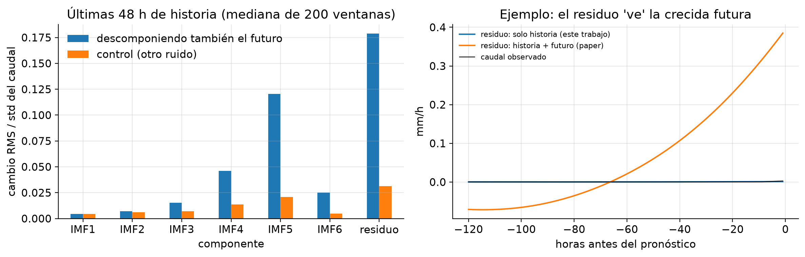{.r-stretch fig-alt="Cambio de los componentes al descomponer también el futuro."}

::: {.key-message}
El paper aplica CEEMDAN a la serie completa y luego la divide: los componentes del pasado "ven" el
futuro. Nosotros descomponemos cada ventana solo con su historia.
:::

::: {.notes}
(≈1 min) Figura clave. EMD no es causal. Al agregar las 48 h futuras, los componentes lentos cambian 4–6
veces más que al cambiar solo el ruido (residuo: 0.179 contra 0.031 desviaciones del caudal). En el
ejemplo, el residuo calculado con el futuro sube a 0.38 mm/h mientras el caudal sigue en ~0. En test no
existe el futuro, así que el protocolo del paper es imposible aquí; además explica por qué esperamos
ganancias menores que las reportadas.
:::

## Nuestro CEEMDAN y MRS

::: {.columns}
::: {.column width="50%"}
**CEEMDAN propio en numba**

- Banco fijo de 100 realizaciones de ruido, reutilizado.
- Spline cúbica natural propia; 10 sifts por IMF.
- 6 IMF + residuo por ventana.
- 300 125 ventanas a 4.6 ms (24 CPUs); error de reconstrucción $10^{-6}$ mm/h.
:::

::: {.column width="50%"}
**MRS automático y global**

- Voto: % de ventanas con $\mathrm{SE}(\mathrm{IMF}_k)>\mathrm{SE}(q)$.
- Voto > 0.5 → RIMF individual de alta frecuencia.
- El resto se suma por bandas de entropía.
- Reproduce la Tabla 3 del paper (test automático).
:::
:::

::: {.key-message}
Un solo modelo para 508 cuencas necesita los mismos canales en todas: la agrupación se decide una vez,
con 8000 ventanas de train.
:::

::: {.notes}
(≈1 min) La agrupación del paper es visual y por estación. Nuestra regla es reproducible y, con los
valores de entropía del paper, da exactamente sus grupos.
:::

## ¿Qué recibe cada rama?

| Entrada | Canales | Contenido |
|---|---:|---|
| Informer (HF) | 18 | 5 RIMF + 11 meteorológicas + 2 estáticos |
| LSTM (LF) | 14 | 1 RIMF + 11 meteorológicas + 2 estáticos |
| Ablación sin MRS | 14 | caudal + 11 meteorológicas + 2 estáticos |

$$
\mathcal{L}_{\mathrm{NSE}^*}=\frac{1}{48N}\sum_{n,h}\left(\frac{\hat{y}_{n,h}-y_{n,h}}{\sigma_b+0.01}\right)^2
$$

::: {.compact}
Escalar por cuenca evita que las cuencas grandes dominen la pérdida. Los 2 canales estáticos
(log $s_b$, log $\mu_b$) devuelven la magnitud que el escalado borra.
:::

::: {.notes}
(≈1 min) La pérdida NSE* de Kratzert et al. (2019) es el estándar en modelos multi-cuenca y está alineada
con la métrica NSE.
:::

## Lo que cambiamos del paper

::: {.small}
| Paper | Este trabajo | Por qué |
|---|---|---|
| CEEMDAN de la serie completa | CEEMDAN de cada ventana | Sin fuga del futuro |
| Agrupación visual por estación | Votos globales | Canales fijos para 508 cuencas |
| Cada modelo predice componentes | Suma entrenada sobre el caudal | Los componentes futuros no existen |
| 7 días → 1–7 días | 336 h → 48 h | Enunciado del laboratorio |
| Embedding de fechas | Omitido | No hay fechas |
| MSE | NSE\* + 2 estáticos | Escalas muy distintas |
| Batch 32, 100 épocas | Batch 256, 100 épocas, mejor época de validación | 250× más datos |
:::

::: {.notes}
(≈45 s) Conservamos la propuesta central: MRS con CEEMDAN y sample entropy, Informer para alta
frecuencia, LSTM para baja y suma de las ramas.
:::

## Cómo entrenamos

::: {.columns .compact}
::: {.column width="50%"}
- Adam, lr $3\times10^{-4}$ con warmup; ReduceLROnPlateau (×0.5).
- Batch 256 · 993 pasos por época · 3.68 M parámetros.
:::

::: {.column width="50%"}
- 100 épocas, como el paper; se guarda la mejor época de validación.
- RTX A6000 · ~2 min por época · ~3.3 h por modelo.
:::
:::

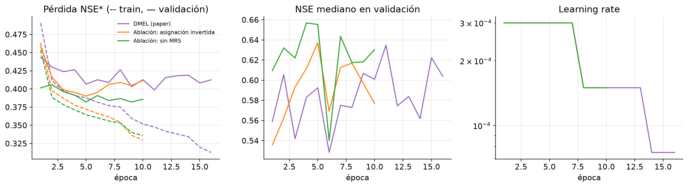{.r-stretch fig-alt="Curvas de pérdida, NSE de validación y learning rate."}

::: {.notes}
(≈45 s) Una época nuestra tiene ~30 veces más actualizaciones que una del paper. La selección de la mejor
época usa solo validación; test se evalúa una sola vez. Desde la época ~10 la validación empeora
(sobreajuste) y hacia la 50 el learning rate llega a su piso: el modelo deja de cambiar.
:::

## ¿Cortaba antes de tiempo el early stopping?

::: {.small}
| Modelo | Early stopping: épocas / mejor | NSE test | 100 épocas: mejor época | NSE test |
|---|---:|---:|---:|---:|
| DMEL | 16 / 11 | 0.629 | 11 | 0.614 |
| Asignación invertida | 10 / 5 | 0.629 | 5 | 0.620 |
| Sin MRS | 10 / 5 | 0.625 | 7 | 0.629 |
:::

- Con 100 épocas se eligen **las mismas épocas** (5–11): el resto es sobreajuste. Costó ~13 h de GPU contra ~2 h.
- DMEL eligió la misma época con la misma pérdida de validación, y su NSE de test varió de 0.629 a 0.614: es el **no determinismo de la GPU**.

::: {.key-message}
La variación entre dos corridas iguales (~0.01–0.015) es del mismo tamaño que las diferencias entre modelos.
:::

::: {.notes}
(≈1 min) Primero entrenamos con early stopping y luego repetimos todo con las 100 épocas del paper para
descartar que hubiéramos cortado antes de tiempo. Reportamos la segunda ronda.
:::

## ¿Qué comparamos?

::: {.small}
| Sistema | Rama 1 | Rama 2 | Pregunta |
|---|---|---|---|
| **Persistencia** | — | — | ¿Qué pasa si repetimos el último valor? |
| **DMEL** | Informer(HF) | LSTM(LF) | Propuesta del paper |
| **Asignación invertida** | LSTM(HF) | Informer(LF) | ¿Importa qué modelo ve cada frecuencia? |
| **Sin MRS** | Informer(caudal) | LSTM(caudal) | ¿Aporta la descomposición? |
| **Variante: DMEL + caudal** | Informer(HF) | LSTM(LF + caudal) | ¿Recupera DMEL las primeras horas? |
:::

::: {.key-message}
Las cuatro redes tienen la misma arquitectura y ~3.7 M parámetros: solo cambia la entrada o la asignación.
:::

::: {.notes}
(≈40 s) La ablación "sin MRS" es también nuestro modelo base entrenado. La variante es propia, no del
paper: responde a que DMEL perdía en las primeras horas en la primera ronda.
:::

# Resultados

## Resultados en test

::: {.columns}
::: {.column width="25%"}
<div class="metric">
<strong>0.614</strong>
NSE mediano DMEL
</div>
:::
::: {.column width="25%"}
<div class="metric">
<strong>0.492</strong>
persistencia
</div>
:::
::: {.column width="25%"}
<div class="metric">
<strong>348/508</strong>
cuencas mejoran
</div>
:::
::: {.column width="25%"}
<div class="metric">
<strong>0.40 vs 0.15</strong>
NSE a 48 h
</div>
:::
:::

::: {.small}
| Test | Persistencia | **DMEL** | Asignación invertida | Sin MRS | Variante |
|---|---:|---:|---:|---:|---:|
| NSE mediano | 0.492 | **0.614** | 0.620 | 0.629 | 0.624 |
| KGE mediano | 0.626 | 0.655 | 0.672 | 0.641 | 0.693 |
| NSE 1 h / 24 h | 0.998 / 0.538 | 0.943 / 0.649 | 0.958 / 0.660 | 0.984 / 0.656 | 0.984 / 0.672 |
| NSE 48 h | 0.150 | 0.403 | 0.399 | 0.413 | 0.412 |
| Cuencas con NSE < 0 | 74 | 37 | 26 | 36 | 39 |
:::

::: {.notes}
(≈1 min) DMEL supera claramente a la persistencia en el agregado (Wilcoxon p = 1.6e-19). Las cuatro redes
quedan cerca entre sí. Validación cuenta lo mismo (0.624 DMEL / 0.646 / 0.665 / 0.662 variante / 0.525
persistencia), así que la selección por validación generaliza a test.
:::

## ¿Cómo cae el desempeño con el horizonte?

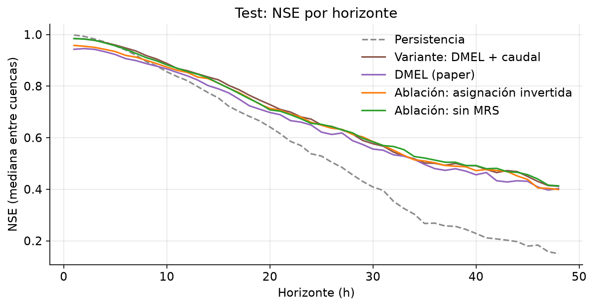{.r-stretch fig-alt="NSE mediano por horizonte de pronóstico."}

::: {.key-message}
Hasta ~6 h gana copiar el último valor; desde ~7 h las redes ganan y a 48 h duplican con creces el NSE de
la persistencia (~0.40 contra 0.15).
:::

::: {.notes}
(≈1 min) En las primeras horas dominan los dos modelos que ven el caudal crudo: sin MRS y la variante
(0.984 a 1 h). DMEL solo ve componentes, cuyas últimas horas son las menos estables por el efecto de borde.
:::

## Las ablaciones

::: {.small}

:::

::: {.key-message}
En las dos rondas, DMEL nunca supera a sus ablaciones: invertir la asignación o quitar el MRS da igual o
levemente mejor. Las diferencias (≤ 0.015) están en el rango de la variación entre corridas.
:::

::: {.notes}
(≈1 min) Wilcoxon pareado sobre el NSE de las 508 cuencas. Es significativo porque compara 508 pares,
pero compara dos modelos entrenados concretos, no dos métodos: no incluye la variabilidad entre
corridas. Lo robusto es la dirección, que se repite en las dos rondas.
:::

## ¿Por qué el MRS no ayuda aquí?

1. **No agrega información**: CEEMDAN es una transformación determinista de la misma historia, y por
   ventana degrada justo las horas más recientes.
2. **El paper se beneficia de la fuga**: con el futuro incluido, los componentes lentos cambian 4–6× más
   que el ruido propio de CEEMDAN (residuo: 0.179 contra 0.031).
3. **Otro problema**: el paper es univariado con 7 días de entrada; aquí las redes también ven la lluvia.

::: {.key-message}
Parte de la mejora reportada por el paper probablemente viene de descomponer la serie completa.
:::

::: {.notes}
(≈1 min) Volver a la figura de fuga: el residuo calculado con el futuro sube antes de la crecida.
:::

## Variante: devolverle el caudal a DMEL

::: {.columns}
::: {.column width="50%"}
**Qué cambia**

- El LSTM recibe el RIMF de baja frecuencia **y** el caudal observado.
- Todo lo demás es DMEL: mismo MRS, mismo Informer, misma suma.
:::

::: {.column width="50%"}
**Resultado en test**

| | DMEL | Variante |
|---|---:|---:|
| NSE a 1 h | 0.943 | **0.984** |
| NSE a 6 h | 0.907 | **0.948** |
| KGE mediano | 0.655 | **0.693** |
| \|EP\| del pico | 41 % | **36 %** |
:::
:::

::: {.key-message}
Recupera las primeras horas y es el mejor en KGE, picos y entre 6 y 24 h. Pero su NSE mediano (0.624)
iguala al modelo sin MRS: la ganancia viene del caudal crudo, no de la descomposición.
:::

::: {.notes}
(≈1 min) A 6 h la variante (0.948) supera incluso a la persistencia (0.940). Wilcoxon contra DMEL:
p = 2e-4.
:::

## Las crecidas

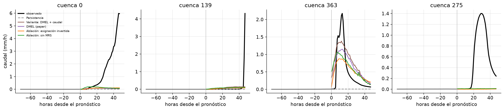{.r-stretch fig-alt="Hidrogramas de las mayores crecidas de test."}

::: {.compact}
Las mayores crecidas parten de caudal ~0: la lluvia que las provoca aún no cae y ningún modelo las
anticipa. Si la subida ya empezó (cuenca 363), la variante es la que más se acerca al pico (≈1.4 contra
2.2 mm/h), seguida de DMEL (≈1.15).
:::

::: {.notes}
(≈45 s) Las variables meteorológicas futuras (y_aux) no están disponibles en inferencia; con lluvia
pronosticada estas crecidas serían predecibles.
:::

## ¿Qué aporta cada rama?

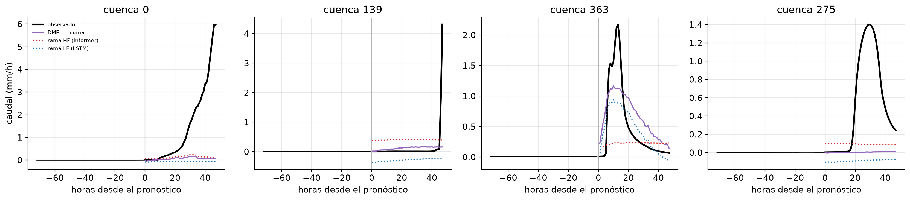{.r-stretch fig-alt="Aporte del Informer y del LSTM en las crecidas."}

::: {.compact}
Las ramas se compensan con desplazamientos casi constantes (+0.35 / −0.3). La crecida de la cuenca 363 la
explica el **LSTM**, que también recibe la lluvia, no el Informer.
:::

::: {.notes}
(≈45 s) Al entrenar sobre la suma, la división en aportes de alta y baja frecuencia no es identificable.
La interpretación del paper ("el Informer captura los cambios bruscos") no se sostiene aquí.
:::

## ¿Dónde falla?

::: {.columns}
::: {.column width="50%"}
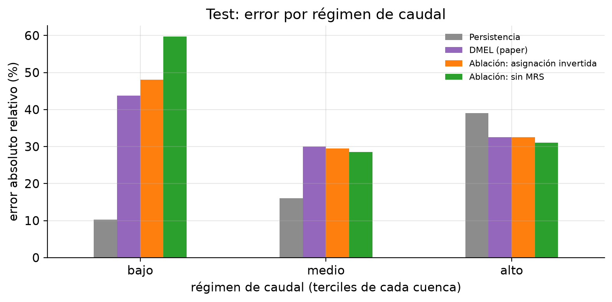{fig-alt="Error por régimen de caudal."}
:::

::: {.column width="50%"}
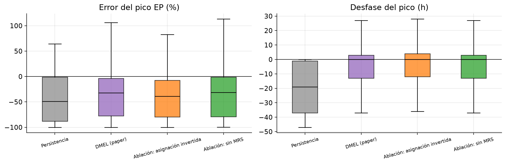{fig-alt="Error y desfase del pico."}
:::
:::

::: {.compact}
- **Caudales bajos**: la persistencia tiene 10 % de error relativo; las redes con MRS 47–49 % y la sin MRS 68 %.
- **Picos**: todos los subestiman (EP mediano de −31 % a −40 %); el desfase baja de 19 h a 7–8 h.
:::

::: {.notes}
(≈1 min) Las cuencas con NSE muy negativo son casi secas (caudal medio < 0.01 mm/h): con tan poca
varianza, errores absolutos pequeños dan un NSE muy negativo.
:::

## Limitaciones

- Sin el futuro, los componentes de las últimas horas son los menos estables (efecto de borde).
- DMEL no ve el caudal crudo: pierde contra la persistencia hasta ~6 h (la variante lo corrige).
- Una sola agrupación MRS para las 508 cuencas.
- Las ramas no se supervisan por separado: su aporte es una interpretación.
- Una semilla por modelo: la variación entre corridas (~0.01) es comparable a las diferencias entre modelos.
- Sin lluvia futura: las crecidas que aún no empiezan son casi impredecibles.

## Conclusiones

::: {.compact}
1. Implementamos DMEL desde cero: CEEMDAN y sample entropy propios, Informer con ProbSparse y LSTM.
2. Descomponer la serie completa, como el paper, filtra información del futuro; lo evitamos por ventana.
3. DMEL supera a la persistencia desde ~7 h (0.40 contra 0.15 de NSE a 48 h; 348 de 508 cuencas).
4. Sin fuga, ni el MRS ni la asignación de frecuencias mejoran a la misma arquitectura con el caudal crudo.
5. Devolverle el caudal observado a DMEL recupera las primeras horas y mejora KGE y picos.
6. 100 épocas eligen las mismas épocas que el early stopping: el resto es sobreajuste.
:::

::: {.key-message}
La idea de separar por frecuencias es elegante, pero en un pronóstico honesto (solo con el pasado) su
ventaja desaparece; lo que más ayudaría es información del futuro que no tenemos: la lluvia pronosticada.
:::

## Apéndice: configuración completa {.smaller visibility="uncounted"}

| Etapa | Valor |
|---|---|
| CEEMDAN | 6 IMF + residuo, 100 realizaciones, ε = 0.2, 10 sifts, semilla 0 |
| Sample entropy | m = 2, r = 0.2·σ |
| MRS | 8000 ventanas de train, voto > 0.5, τ = 0.1 |
| Escala | $s_b=\sigma_b+0.01$ mm/h; z-score con 20 000 ventanas |
| Informer | d_model 256, 8 cabezas, 2 enc + 1 dec, d_ff 1024, c = 5, dropout 0.1 |
| LSTM | 2 × 256, dropout 0.1, Linear(256 → 48) |
| Entrenamiento | Adam 3e-4, warmup 500, batch 256, 100 épocas (mejor época de validación), clip 1.0, TF32 |

## Apéndice: todas las métricas de test {.smaller visibility="uncounted"}



## Apéndice: entrenamiento {visibility="uncounted"}

::: {.small}

:::

## Apéndice: NSE de las cuencas por horizonte {visibility="uncounted"}

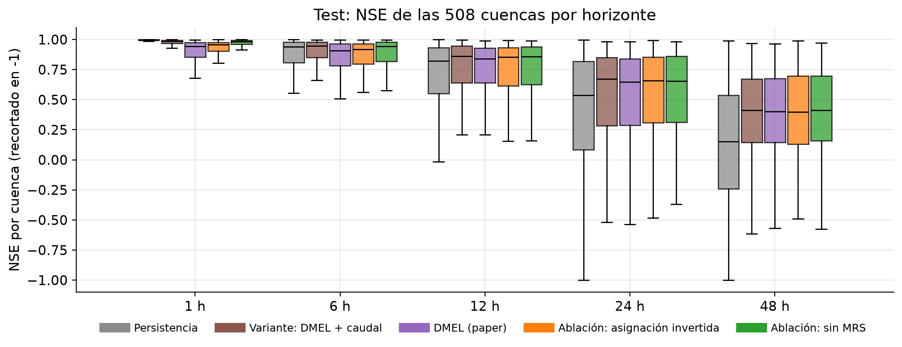{.r-stretch fig-alt="NSE de las cuencas por horizonte y modelo."}

## Apéndice: desempeño vs magnitud del caudal {visibility="uncounted"}

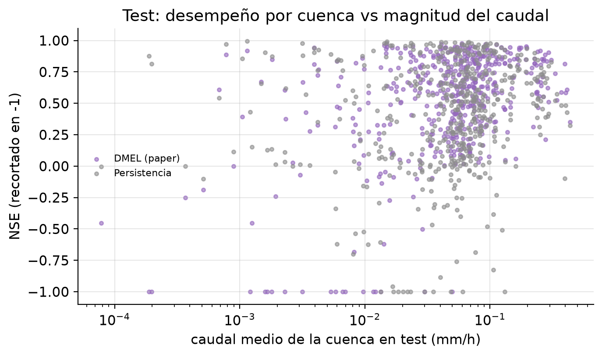{.r-stretch fig-alt="NSE por cuenca frente a su caudal medio."}

## Apéndice: MRS en números {visibility="uncounted"}

::: {.small}

:::

## Apéndice: distribución del NSE por cuenca {visibility="uncounted"}

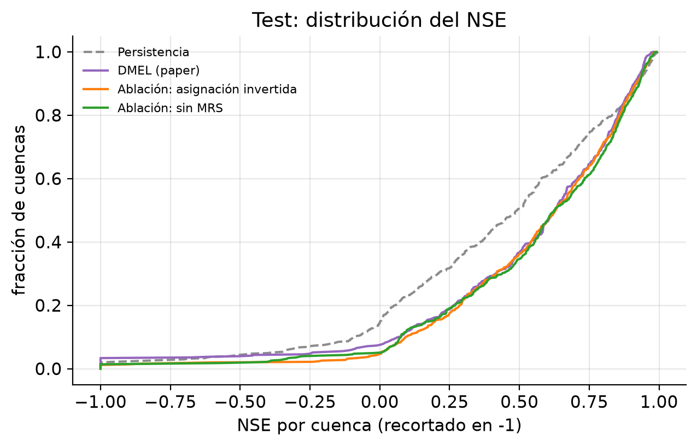{.r-stretch fig-alt="Distribución acumulada del NSE por cuenca."}

## Apéndice: observado vs pronosticado a 24 h {visibility="uncounted"}

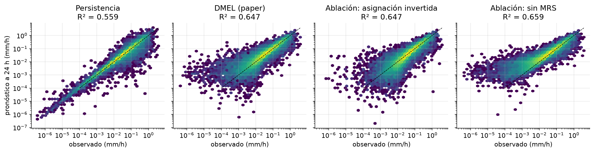{.r-stretch fig-alt="Dispersión de observado frente a pronosticado."}

## Apéndice: código de la implementación {.smaller visibility="uncounted"}

| Componente | Archivo y símbolo |
|---|---|
| CEEMDAN mejorado | `src/dmel/ceemdan.py::iceemdan` |
| Spline natural y envolventes | `src/dmel/ceemdan.py::natural_spline`, `envelope` |
| Sample entropy y regla MRS | `src/dmel/mrs.py::sample_entropy`, `propose_groups` |
| ProbSparse | `src/dmel/informer.py::prob_attention` |
| Informer | `src/dmel/informer.py::Informer` |
| LSTM y ensamble dual | `src/dmel/models.py::LSTMNet`, `TwoBranch` |
| Entradas y escala por cuenca | `src/dmel/data.py::make_inputs`, `basin_scales` |
| Entrenamiento | `src/dmel/train.py::main` |
| Métricas y figuras | `src/dmel/metrics.py`, `src/dmel/plots.py` |
